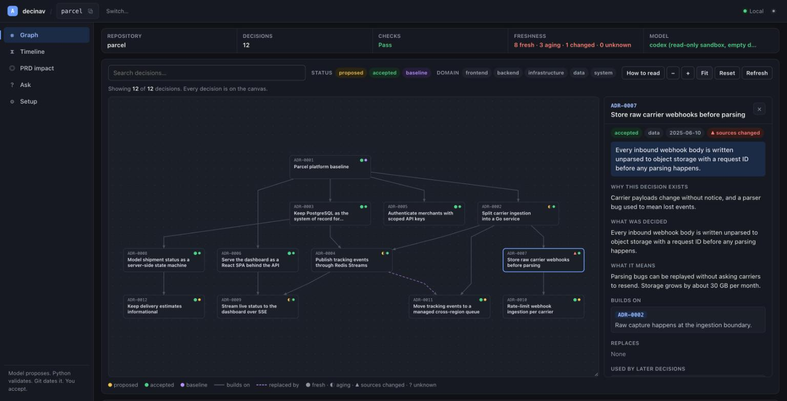
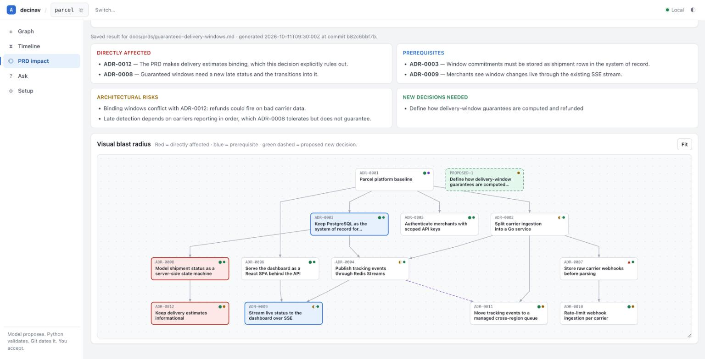
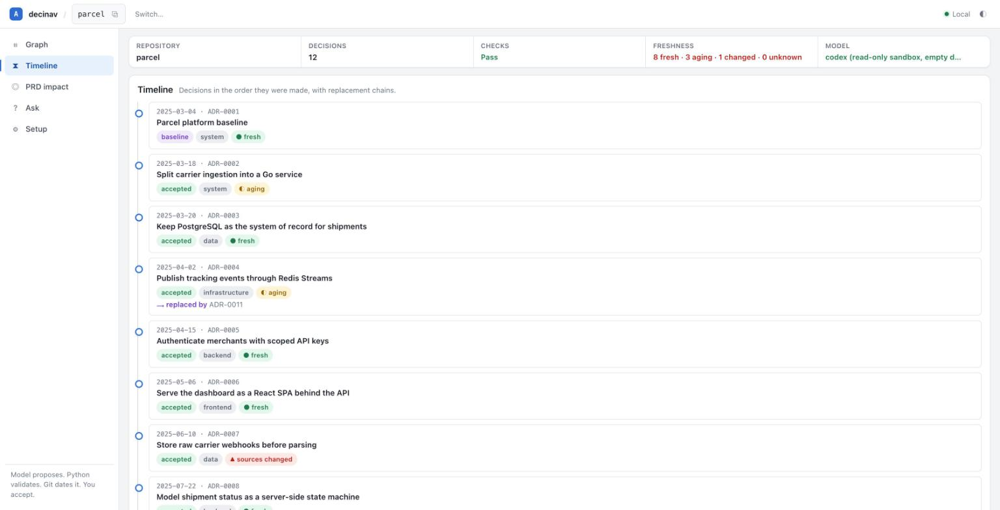

# decinav

**Your architecture decisions become a validated, queryable graph that your
coding agent consults before changing the system.**

Ask why a decision exists and get an answer that cites the record. Plan a
feature against the decisions it touches, before code exists. Record new
decisions through a gate that a human approves. Every write is checked by
deterministic code, never by the model.

```text
developer in Claude Code:  /decinav:decinav-plan "add report export"
    -> agent reads the validated decisions       decinav context --format json
    -> agent writes a PRD from the template      decinav prd new / prd lint
    -> agent checks the blast radius             decinav impact <prd> --save
    -> agent proposes new decisions              decinav propose --from-file
    -> deterministic gate validates and publishes them as proposed
    -> a human accepts or rejects                decinav accept / reject
    -> the commit hook asks for [ADR-XXXX] on changes to your code folders
```

The durable source of truth is a folder of Markdown files under `docs/adr/`,
reviewable in any pull request. The graph, the freshness signals, and the
browser workbench are derived from those files.



*The workbench on a demo project. ADR-0007 is open: a commit touched its source file after it was accepted, so it reads "sources changed".*

## 60-second start

```bash
pipx install git+https://github.com/onestopengineering/decinav   # brew install pipx, if needed
cd your-repo
decinav setup                # finds claude or codex on PATH, saves .decinav/config.json
```

Try it on a demo project first, no repository of your own needed:

```bash
git clone https://github.com/onestopengineering/decinav && cd decinav
python3 scripts/build_demo.py /tmp/parcel   # needs decinav installed, as above
decinav ui --project /tmp/parcel
```

Existing product with code:

```bash
decinav init --existing      # docs/adr, warning-only commit hook, nothing committed
decinav baseline             # Day 0 record from manifests and compose files
decinav ingest docs/decisions   # proposed ADRs from your docs, one folder at a time
```

New product with only a brief:

```bash
decinav init
decinav baseline --from-brief docs/product-brief.md
```

The model runs isolated: an empty working directory, no tools, the prompt on
stdin. Nothing in your repository reaches it except the files the command bundles.

Install the skill pack in your coding agent, then plan your first change:

```text
/plugin marketplace add onestopengineering/decinav
/plugin install decinav@decinav
/decinav:decinav-plan "Add CSV export for course reports"
```

Claude Code namespaces plugin skills, hence `/decinav:decinav-plan`. Codex, Cursor, and
other hosts use `./install.sh` from the repository root; see
[Working with your coding agent](#working-with-your-coding-agent).

## How it works

Three roles, kept separate on purpose:

| Role | Does | Never does |
|---|---|---|
| Coding agent (the model) | Reads the validated corpus, inspects code, writes PRDs, proposes ADRs, answers questions | Writes into `docs/adr` directly |
| Deterministic Python core | Parses strict frontmatter, validates the whole prospective repository, publishes atomically, records provenance, renders the graph, checks answers | Decides architectural truth |
| Human | Accepts or rejects proposals, attests decisions as current | Needs to run the individual commands |

```text
Human decision, product brief, or informal documentation
                  |
      Human authoring or agent extraction
                  |
         Strict ADR Markdown (schema V2)
                  |
   Deterministic validation of the whole prospective repository
                  |
          Atomic, non-overwriting publish as "proposed"
                  |
          Human accept / reject / attest
                  |
   Graph, freshness, CI validation, commit policy, agent context
```

The model understands messy language and proposes decisions. Code controls
what becomes trusted state. A human approves architectural truth.

## Commands

Deterministic commands need no model. Model-backed commands use the model saved
by `decinav setup` (or `DECINAV_AI_CMD` as an override), or are driven by your
coding agent through the skills.

| Command | What it does | Model |
|---|---|---|
| `setup [--model claude\|codex\|command\|none]` | Detect a local model CLI once and save it to `.decinav/config.json` | no |
| `init [--existing] [--overwrite-hook] [--watch <folder>]...` | Create `docs/adr`, install the commit-msg policy on the detected code folders (`src`, `app`, `lib`, `infra`, ...), keep ADRs trackable when `/docs` is ignored | no |
| `new "<title>" --domain <d> [--depends-on ID] [--supersedes ID]` | Create the next proposed ADR; prompts for a reason per relationship; rejects unknown references | no |
| `graph [--focus ID --depth N] [--domain <d>]` | Regenerate the Mermaid graph in `docs/adr/README.md` | no |
| `validate` | Strict schema and graph integrity check; exit 1 for CI | no |
| `context [--format text\|json] [--compact] [--ids ...]` | The validated ADR bundle with provenance and freshness, for an agent | no |
| `propose --from-file <envelope.json>` | Publish agent-authored ADRs through the strict gate as proposed | no |
| `accept <ID>...` | Promote proposed ADRs to accepted and record the reviewer commit | no |
| `reject <ID>` | Delete a proposed ADR that nothing references | no |
| `attest <ID>...` | Record that a human reviewed these ADRs as current now | no |
| `check-answer [file] [--require-states]` | Reject answers with uncited factual lines, unknown IDs, or missing claim states | no |
| `prd new "<title>"` / `prd lint <file>` | Grounded PRD template; lint required sections and ADR references | no |
| `baseline [--from-brief <file>]` | The one Day 0 record, from structural files or from a product brief | yes |
| `ingest <folder>` | Extract atomic proposed ADRs from `.md`, `.txt`, `.rst`, `.adoc` | yes |
| `impact <prd.md> [--visual] [--save]` | Which decisions a PRD changes, relies on, or contradicts | yes |
| `query "<question>"` | An answer where every factual line cites an ADR | yes |
| `ui [--project <path>] [--port N] [--no-open]` | Loopback browser workbench | optional |

## Working with your coding agent

The skill pack under `decinav-plugin/` teaches the agent the loop. Every skill
calls the deterministic commands above and never writes ADR files directly.

| Skill | What the agent does |
|---|---|
| `/decinav-init` | Detects new versus existing product, runs `init`, explains the loop and the commit policy |
| `/decinav-plan <feature>` | Reads `context`, inspects code, writes a PRD from the template, lints it, runs `impact --save` |
| `/decinav-decide` | Turns the PRD's proposed decisions into an envelope and runs `propose` |
| `/decinav-query <question>` | Answers from `context`, verifies each claim in code, labels it, runs `check-answer --require-states` |
| `/decinav-review` | Lists proposed ADRs with their evidence so a human can `accept` or `reject` |
| `/decinav-impact <prd>` | Runs `impact --save` on an existing PRD and explains the result |

Install into Claude Code:

```text
/plugin marketplace add onestopengineering/decinav
/plugin install decinav@decinav
```

As a plugin, each skill is invoked with the plugin prefix: `/decinav:decinav-plan`,
`/decinav:decinav-query`, and so on. Local installs through `./install.sh` drop the prefix.

Install into Codex, Cursor, or another host:

```bash
./install.sh codex
```

### The proposal envelope

`propose` reads the same envelope that `ingest` demands from a model. The agent
writes it to a file; the gate validates the complete prospective repository
before anything is written.

```json
{
  "records": [
    {
      "filename": "0007-generate-exports-in-a-background-job.md",
      "content": "---\nschema_version: 2\nid: \"ADR-0007\"\n...\n---\n\n# ...\n\n## Context\n...\n## Decision\n...\n## Consequences\n...\n## Sources\n\n- docs/prds/report-export.md\n"
    }
  ],
  "provenance": {
    "generator": "claude-code",
    "sources": ["docs/prds/report-export.md"]
  }
}
```

Rules the gate enforces: exact V2 frontmatter, contiguous IDs starting at the
next free number, filename matching the ID, every relationship target existing,
no cycles, `status: proposed`, and a `## Sources` section. Any failure means
zero files are written.

### Claim states

An agent answer is only accepted when every factual line cites a known ADR and,
with `--require-states`, carries exactly one state:

```text
- Evaluation is dispatched asynchronously [ADR-0002] [VERIFIED_IN_CODE]
- Step completion is stored in step_completions [ADR-0018] [CONTRADICTED]
- The ADRs do not establish the production queue topology [UNKNOWN]
```

`DOCUMENTED` means an ADR says it. `VERIFIED_IN_CODE` means the agent found it
in the code at this revision. `CONTRADICTED` means the code disagrees with the
record. `UNKNOWN` is an abstention and needs no citation.

```bash
decinav check-answer answer.md --require-states
```

## New product versus existing product

**New product, recommended path.** There is no code yet. The first record is an
intended-architecture baseline derived from the product brief, labeled as
intended and never as observed. Every feature then goes through plan, impact,
decide, accept.

```bash
decinav init
decinav baseline --from-brief docs/product-brief.md
/decinav-plan "First feature"
```

**Existing product with some documentation.** Start from structure, then
extract decisions from the documents you trust. Everything extracted is
proposed until a human accepts it.

```bash
decinav init --existing
decinav baseline                       # structural files only, never source
decinav ingest docs/decisions           # proposed ADRs with Sources sections
decinav ui                              # inspect proposed decisions in the browser
decinav accept ADR-0002 ADR-0003        # the human review gate
```

Ingest accepts `.md`, `.txt`, `.rst`, and `.adoc`. It never reads `docs/adr`
as a source, applies a 128 KiB per-file and 1 MiB total limit, and records the
source paths of every generated record.

## Provenance and freshness

Every write records where a decision came from in `.decinav/provenance.json`:

```json
{
  "schema_version": 1,
  "records": {
    "ADR-0002": {
      "generated_by": "ingest",
      "generator": "claude",
      "generated_at": "2026-09-28T01:02:03Z",
      "commit": "1583fc1...",
      "sources": ["docs/feature-specs/submissions.md"],
      "accepted_at": null,
      "accepted_commit": null,
      "attested_at": null,
      "attested_commit": null
    }
  }
}
```

Freshness is computed from Git whenever the corpus is read. It is a signal,
not a semantic verification.

| State | Meaning |
|---|---|
| `fresh` | No project commits since the recorded commit (attested if present, else accepted, else generated) |
| `aging` | Commits since, but none touched the recorded sources |
| `sources-changed` | At least one commit since touched a recorded source |
| `unknown` | No provenance, commit not found, or not a Git repository |

Commits that only touch `docs/adr` or `.decinav` never age a decision. When a
human confirms a decision still holds, `decinav attest ADR-0002` resets the
reference commit to now.

## Browser workbench

```bash
decinav ui --project /path/to/repository
```

The workbench is a viewer over the same files the agent works with. It shows
the decision graph with a layered layout, lets you click a node to read the
full decision, its relationships with reasons, provenance, and freshness,
search by ID or title, focus on a neighborhood, filter by status and domain,
and overlay the last saved impact result. It also runs initialization,
baseline, ingest, validation, graph refresh, PRD impact, and queries for people
who do not use the CLI.

The server binds only to a loopback address, embeds a random per-process token
in the served page, sends no CORS permission, loads no internet dependency, and
serves only its packaged assets.

Before a feature is built, the impact view shows which decisions it changes (red),
which it relies on (blue), and which decisions are still missing (green, dashed):



The timeline lists decisions in the order they were made, with what replaced what:



## Headless and CI

`baseline`, `ingest`, `impact`, and `query` can run without an agent host by
calling a local model CLI. Configure the process template with `DECINAV_AI_CMD`:

```bash
export DECINAV_AI_CMD='claude -p --tools ""'          # prompt through stdin
export DECINAV_AI_CMD='claude -p "{prompt}"'          # prompt as an argument
export DECINAV_AI_CMD='agent --prompt-file "{prompt_file}"'
```

The template is parsed with `shlex` and executed without a command shell. Use
`{prompt_file}` or stdin for large repositories to avoid argument limits. Set
`DECINAV_AI_TIMEOUT_SECONDS` to override the 300-second default.

Deterministic tests use a mock:

```bash
export DECINAV_AI_CMD=mock
export DECINAV_AI_MOCK_RESPONSE=/absolute/path/to/fixture
export DECINAV_AI_MOCK_IMPACT_RESPONSE=/absolute/path/to/mock_impact.json
export DECINAV_AI_MOCK_QUERY_RESPONSE=/absolute/path/to/mock_query.txt
```

In CI:

```bash
decinav validate        # exit 1 on any schema or graph problem
```

The commit-msg hook installed by `init` requires `[ADR-XXXX]` or `[skip-adr]`
in the message when staged changes touch `src/` or `infra/`. `--existing`
installs the warning-only variant for brownfield adoption. If a foreign hook
exists, `init` stops; `--overwrite-hook` makes a timestamped backup first.

## ADR schema

ADRs without a `schema_version` keep the original V1 string-list format and
remain readable. New and generated ADRs use strict V2 frontmatter:

```yaml
---
schema_version: 2
id: "ADR-0002"
title: "Dispatch evaluation asynchronously"
status: "proposed"
date: "2026-08-27"
domain: "backend"
depends_on:
  - id: "ADR-0001"
    reason: "The baseline establishes the Laravel and Go service boundary."
supersedes: []
---
```

Statuses: `proposed`, `accepted`, `deprecated`, `superseded`, `baseline`.
Domains: `frontend`, `backend`, `infrastructure`, `data`, `system`.
V2 relationship items must contain exactly `id` and a non-empty `reason`.
Unknown keys and unsupported schema versions are rejected. The graph renders
dependency and supersession edges with their reasons, colors nodes by domain,
and links each node to its Markdown file.

`validate` aggregates every integrity failure: malformed frontmatter,
filename and ID mismatch, duplicate IDs, dangling references, and causal
cycles. `graph` warns and still renders every unambiguous record.

## Security notes

- Baseline discovery sends only recognized structural files: manifests,
  Dockerfiles and Compose files, Terraform without variable files, CI
  workflows, recognized Kubernetes manifests. It excludes source code,
  lockfiles, `.env` files, dependency and build directories, and any
  Kubernetes manifest containing a Secret.
- Ingest sends only the documents in the folder you choose, never `docs/adr`.
- The model is executed without a shell. It still runs with whatever
  permissions the configured CLI has, so run it with tools disabled, as in
  `claude -p --tools ""`, or in a read-only sandbox.
- Model output is never trusted because it sounds plausible. It becomes
  repository state only after deterministic validation, as `proposed`.

## Development

```bash
python3 -m venv .venv
.venv/bin/pip install -e '.[dev]'
.venv/bin/pytest
python scripts/run_e2e.py            # brownfield fixture: init, baseline, ingest, graph, validate, hook
python scripts/run_e2e.py --keep     # retain the generated repository
```

The fixture under `tests/fixtures/legacy-monolith/` mixes Node, Maven, Python,
Docker Compose, Terraform, Kubernetes, informal decisions, raw source,
lockfiles, environment secrets, and a Kubernetes Secret. The runner proves that
only safe structural context reaches baseline generation.

## Status

Version 0.8.0. Deterministic behavior is covered by the test suite and the
end-to-end fixture. The model-backed features were evaluated once on a real
Laravel repository with a real model: PRD impact found every relevant decision
with 95 percent precision on directly affected records, and query answers were
always correctly cited but were sometimes confidently stale when the source
documents were. The provenance sidecar, freshness states, proposed-only
publication, and claim states in this release are the response to that finding.

Not yet verified: semantic accuracy of the new claim-state answers with a real
model at scale, and behavior with two writers publishing into the same
repository at the same time. Treat generated ADRs as proposals until a human
accepts them.

## License

MIT. See [LICENSE](LICENSE).
