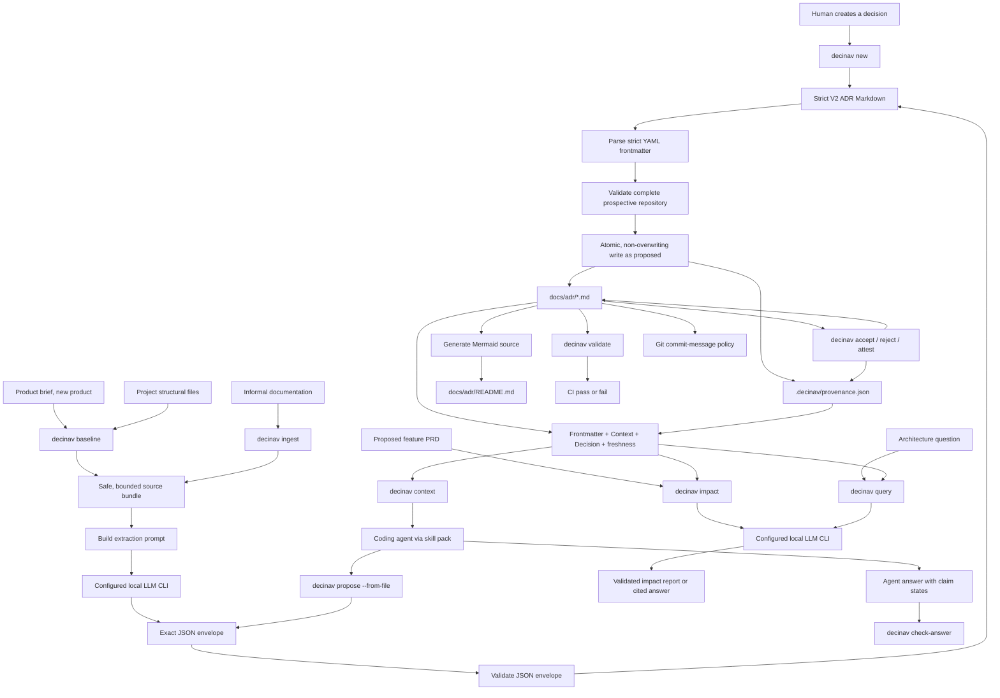

# How `decinav` Works

## Executive summary

`decinav` treats Architecture Decision Records (ADRs) as structured project data rather than disconnected Markdown notes.

Since 0.8.0 the tool is agent-first. A coding agent (Claude Code, Codex, Cursor, or any CLI that can run shell commands) calls `decinav`; `decinav` provides what the agent must not be trusted with: the validated corpus, the deterministic gates, and the writes.

The tool supports three ways of creating ADRs:

1. A human creates a decision through `decinav new`.
2. A coding agent proposes decisions through `decinav propose --from-file`, driven by the skill pack.
3. A local LLM subprocess proposes decisions through `decinav baseline` or `decinav ingest`.

All paths converge on the same strict ADR format, the same deterministic validation rules, and the same review gate: generated decisions are published as `proposed`, and a human promotes them with `decinav accept`.

The tool also uses the validated ADR repository for read-only intelligence:

1. `decinav context` serializes the validated corpus, with provenance and freshness, for an agent.
2. `decinav impact` evaluates a proposed PRD's architectural blast radius.
3. `decinav query` answers architecture questions with inline ADR citations.
4. `decinav check-answer` rejects agent answers that lack citations or claim states.

`decinav ui` exposes onboarding, graph inspection, impact analysis, and querying through a loopback-only browser workbench. The UI calls the same Python workflows; it is not a separate implementation of the rules.

The central design principle is:

> The model understands messy language and proposes decisions. Deterministic code controls what becomes trusted architecture state. A human approves architectural truth.

The model does not validate the repository, generate the Mermaid graph, enforce Git policy, promote a decision to accepted, or decide whether invalid output should be accepted.

---

## The mental model

`decinav` behaves like a small compiler and database for architecture decisions.

```text
Human decision, product brief, or informal documentation
                  ↓
   Human authoring, agent proposal, or LLM extraction
                  ↓
         Strict ADR Markdown format
                  ↓
       Deterministic Python validation
                  ↓
     Atomic publish as "proposed" + provenance
                  ↓
       Human accept / reject / attest
                  ↓
        Validated ADR repository
                  ↓
  Mermaid graph + freshness + CI + Git policy + agent context
```

The agent-first loop looks like this from a developer's seat:

```text
developer in Claude Code: /decinav-plan "add report export"
    → skill: run `decinav context --format json`
    → agent reasons with ADRs and code it can read itself
    → agent writes a PRD from the template, runs `decinav prd lint`
    → agent runs `decinav impact <prd> --save`
    → agent writes an ADR envelope, runs `decinav propose --from-file`
    → decinav validates the prospective repository and publishes as proposed
    → human runs `decinav accept` / `decinav reject`
    → commit hook requires [ADR-XXXX] on src/ and infra/ changes
```

The durable source of truth is the collection of Markdown files under `docs/adr/`.

The Mermaid graph in `docs/adr/README.md` is derived state. It can always be regenerated from the ADR metadata.

---

## Complete system flow



---

## When the LLM is used

The LLM participates only in these commands:

```text
decinav baseline
decinav ingest <folder>
decinav impact <prd.md>
decinav query "<question>"
```

### `decinav baseline`

`baseline` creates the one permitted Day 0 baseline ADR for a repository that has no existing ADR files.

The workflow is:

```text
recognized structural files
        ↓
safe source filtering
        ↓
local LLM CLI
        ↓
exactly one ADR-0001 proposal
        ↓
deterministic validation
        ↓
0001-baseline.md
```

Baseline discovery deliberately avoids reading application source code. It includes recognized structural files such as:

- `composer.json`
- `package.json`
- `pyproject.toml`
- `go.mod`
- Dockerfiles and Compose files
- Terraform files, excluding variable files
- CI workflow files
- recognized Kubernetes manifests

It excludes dependency directories, lockfiles, environment files, generated output, source code, and Kubernetes Secret manifests.

The baseline should describe only what the supplied evidence proves. Package presence alone should not be treated as proof that a technology is active in production.

### `decinav ingest`

`ingest` extracts atomic architectural decisions from informal documentation.

Supported source formats are:

- Markdown: `.md`
- Plain text: `.txt`
- reStructuredText: `.rst`
- AsciiDoc: `.adoc`

The LLM performs the semantic work that deterministic code cannot perform reliably:

- Distinguishing a decision from an instruction, feature description, or test report.
- Identifying the problem and context behind a decision.
- Extracting the chosen approach.
- Describing positive, negative, and operational consequences.
- Classifying status and architecture domain.
- Finding causal relationships between decisions.
- Preserving uncertainty when the documentation is incomplete.
- Surfacing contradictions instead of silently resolving them.

The LLM returns proposals. It does not directly publish trusted ADR files.

### `decinav impact`

`impact` sends the complete PRD plus a minimized view of every validated ADR to the LLM. Each ADR contributes only its YAML frontmatter, `Context`, and `Decision`; a Day 0 `Baseline` section is treated as the decision-equivalent section.

The LLM identifies directly affected ADRs, prerequisites, contradictions, and titles for decisions that do not exist yet. Deterministic code validates the response schema and rejects references to unknown ADR IDs. With `--visual`, the existing graph is rendered to stdout with red affected nodes, blue prerequisites, and green dashed proposed-decision nodes. The repository is not modified.

### `decinav query`

`query` uses the same minimized ADR context. The LLM acts as a Principal Architect and must cite every architectural assertion using inline references such as `[ADR-0002]`.

Deterministic code rejects answers with no citations or citations to ADRs outside the current repository. It cannot reliably prove that every sentence is correctly supported, so human judgment remains necessary for important decisions.

---

## The local AI boundary

`decinav` does not contain a REST client for a specific AI provider. It runs a configured local command-line process through `DECINAV_AI_CMD`.

Examples:

```bash
export DECINAV_AI_CMD='claude -p "{prompt}"'
export DECINAV_AI_CMD='sol run --prompt "{prompt}"'
export DECINAV_AI_CMD='agent --prompt-file "{prompt_file}"'
export DECINAV_AI_CMD='agent-that-reads-stdin'
```

The adapter supports three prompt transports:

1. Command argument through `{prompt}`.
2. Temporary prompt file through `{prompt_file}`.
3. Standard input when no placeholder is configured.

The configured command is parsed with `shlex` and executed without invoking a command shell.

This prevents shell interpolation inside `decinav`, but the selected local AI CLI must still be configured safely. For example, a coding agent should run in an isolated directory with tools disabled or a read-only sandbox when it only needs to process the supplied prompt.

For `baseline` and `ingest`, the AI process must return exactly one JSON object:

```json
{
  "records": [
    {
      "filename": "0002-use-postgresql.md",
      "content": "---\nschema_version: 2\n..."
    }
  ]
}
```

Conversational text, Markdown fences, extra fields, duplicate JSON keys, empty records, and unsafe filenames are rejected.

`impact` uses its own strict JSON schema and tolerates one outer `json` Markdown fence. `query` returns cited Markdown text rather than JSON.

---

## What happens after a generation LLM responds

The LLM response passes through deterministic gates before any generated ADR batch is published.

```text
LLM stdout, or an agent's envelope file
    ↓
Is it exactly one JSON object?
    ↓
Does it contain only records (plus an optional provenance block)?
    ↓
Are all filenames safe and unique?
    ↓
Does every ADR use the strict V2 schema?
    ↓
Is every status "proposed" (baseline excepted)?
    ↓
Does every record carry a "## Sources" section?
    ↓
Are generated IDs contiguous?
    ↓
Do filenames match their ADR IDs?
    ↓
Do all relationship targets exist?
    ↓
Are IDs unique across the future repository?
    ↓
Is the causal graph free of cycles?
    ↓
Stage and publish the complete batch as proposed
    ↓
Record provenance: generator, sources, commit
    ↓
Human: decinav accept, reject, or attest
```

The same gate serves three producers: the `ingest` and `baseline` subprocess path, the agent's `propose --from-file` path, and human authoring through `new`, which additionally refuses relationships to ADRs that do not exist.

### Validation includes

- Exact frontmatter fields.
- Supported schema version.
- Valid IDs from `ADR-0001` through `ADR-9999`.
- Valid status and domain values.
- Real ISO dates.
- Filename and frontmatter ID agreement.
- Unique ADR IDs.
- Non-empty relationship reasons in V2.
- Existing dependency and supersession targets.
- No causal relationship cycles.
- Contiguous IDs for generated batches.
- No generated filename collision.
- `status: proposed` for every generated or proposed record.
- A `## Sources` section in every generated or proposed record.

The complete prospective repository is validated before writing, not only each candidate in isolation.

### The review gate

A generated ADR is a proposal until a human acts on it.

| Command | Effect |
|---|---|
| `decinav accept ADR-0007` | Rewrites `status: proposed` to `status: accepted`, records the reviewer's commit in provenance, regenerates the graph |
| `decinav reject ADR-0007` | Deletes the file, but only when no other ADR depends on or supersedes it; removes its provenance entry |
| `decinav attest ADR-0002` | Records that a human reviewed the ADR as current at the present commit, which resets its freshness reference |

Accept and reject refuse to run against an invalid repository, and both refuse non-proposed records.

### Batch publication

After validation:

1. Every candidate is written to a temporary staging directory.
2. File contents are flushed and synchronized to disk.
3. Files are published without overwriting existing targets.
4. If publication fails, already-published files from that batch are rolled back.
5. The Mermaid graph is regenerated after successful publication.

If graph regeneration fails after valid ADR files have been written, the ADR files are retained and the user is told to repair the graph target and rerun `decinav graph`.

---

## Provenance and freshness

Every write records where a decision came from. The sidecar lives at `.decinav/provenance.json`, outside `docs/adr`, so the strict V2 frontmatter stays untouched.

```json
{
  "schema_version": 1,
  "records": {
    "ADR-0002": {
      "generated_by": "ingest | baseline | baseline-brief | propose | new",
      "generator": "claude | codex | human | <agent name>",
      "generated_at": "2026-09-28T01:02:03Z",
      "commit": "1583fc1...",
      "sources": ["docs/feature-specs/x.md"],
      "accepted_at": null,
      "accepted_commit": null,
      "attested_at": null,
      "attested_commit": null
    }
  }
}
```

Freshness is computed from Git whenever the corpus is read. The reference commit is the attested commit if present, else the accepted commit, else the generated commit.

| State | Meaning |
|---|---|
| `fresh` | Zero project commits since the reference commit |
| `aging` | Commits since, none touching the recorded sources |
| `sources-changed` | At least one commit since touched a recorded source |
| `unknown` | No provenance, commit not found, or not a Git repository |

Commits that only touch `docs/adr` or `.decinav` are excluded, so recording decisions never ages other decisions. Freshness is a signal that a record may be outdated. It is not a semantic verification that the record is wrong.

Freshness appears in three places: as a `FRESHNESS:` line under each record in `decinav context`, in the browser workbench's node inspector, and inside the prompt context for `impact` and `query`, where the prompt instructs the model to say when a cited decision is proposed or possibly outdated.

This is the direct response to the evaluation on a real repository, where stale documents became structurally valid ADRs and produced confidently cited but implementation-false answers.

---

## Claim states

When a coding agent answers a question through the `/decinav-query` skill, it can read the code as well as the ADRs. `decinav check-answer --require-states` demands that every factual line carry exactly one state:

| State | Meaning |
|---|---|
| `[DOCUMENTED]` | An ADR states this; the agent did not verify it in code |
| `[VERIFIED_IN_CODE]` | The agent found the behavior in the code at this revision |
| `[CONTRADICTED]` | The code disagrees with the cited record |
| `[UNKNOWN]` | The ADRs do not establish an answer; no citation required |

```text
- Evaluation is dispatched asynchronously [ADR-0002] [VERIFIED_IN_CODE]
- Step completion is stored in step_completions [ADR-0018] [CONTRADICTED]
- The ADRs do not establish the production queue topology [UNKNOWN]
```

The deterministic check proves shape and reference integrity: every cited ID exists, every factual line is cited and labeled. It does not prove that the label is correct. Human judgment remains necessary for consequential answers.

---

## Commands that do not use an LLM

The following commands are fully deterministic:

```text
decinav init
decinav new
decinav graph
decinav validate
decinav context
decinav propose
decinav accept
decinav reject
decinav attest
decinav check-answer
decinav prd new
decinav prd lint
```

### `decinav context`

Serializes the validated corpus for an agent: frontmatter, Context, Decision, and for each record its provenance and freshness. `--format json` is the agent-facing payload; the text form is the same condensed bundle the prompts use. It refuses an invalid repository.

### `decinav propose`

Reads an envelope file written by an agent and pushes it through the same gate as `ingest`, with `status: proposed` and a Sources section required. An optional `provenance` object names the generator and sources.

### `decinav prd new` and `decinav prd lint`

`prd new` writes `docs/prds/<slug>.md` from a template whose required sections are Problem, Users, Requirements, Affected decisions, Proposed decisions, Open questions, and Sources. `prd lint` checks that every section exists and has content, and that every `ADR-XXXX` mentioned exists in the repository. The fresh template fails lint on purpose: the agent or the author has to fill it.

### `decinav baseline --from-brief`

For a new product with no code, the Day 0 record is derived from the product brief. The prompt states that it describes intended architecture, the record must say so in its first paragraph, and its Sources section names the brief. This must never be mislabeled as an observed code baseline.

`decinav ui` itself does not require an LLM. Actions selected inside it use an LLM only when they call `baseline`, `ingest`, `impact`, or `query`.

## Browser workbench

```text
browser on 127.0.0.1
        ↓ authenticated local JSON request
Python standard-library HTTP server
        ↓
existing decinav workflow
        ↓
validated repository state or read-only intelligence result
        ↓
offline SVG graph + structured UI result
```

The server accepts repository paths because it is a local developer tool, but it binds only to loopback and requires a random per-process request token. The page has no cross-origin API permission. PRD files are read by the browser and their text is evaluated without persisting an upload.

The workbench covers initialization, baseline creation, documentation ingestion, validation, graph regeneration, PRD impact analysis, and architecture querying. Mermaid remains the export format for Markdown and terminal output; the browser uses a dependency-free SVG renderer so visual inspection works offline.

### `decinav init`

Initializes ADR management in a Git repository.

It:

- Resolves the real Git worktree root.
- Creates `docs/adr/README.md` if it does not exist.
- Installs a managed `commit-msg` hook.
- Refuses to silently overwrite an unrelated existing hook.
- Supports strict mode for new projects.
- Supports warning-only mode through `--existing` for brownfield adoption.

### `decinav new`

Creates one human-authored ADR.

```bash
decinav new "Move uploads to object storage" \
  --domain infrastructure \
  --depends-on ADR-0004
```

The command:

- Allocates the next available numeric ID.
- Prompts for a reason behind every relationship.
- Creates a strict V2 ADR template.
- Refuses to overwrite an existing file.
- Opens the new ADR in `$EDITOR` when configured.

`new` does not automatically regenerate the graph. Run `decinav graph` after editing the decision.

### `decinav graph`

Reads validated ADR metadata and generates Mermaid text.

It can render:

- The global graph.
- A focused graph around one ADR and a requested depth.
- A graph limited to one architecture domain.

The graph includes:

- Decision nodes.
- Dependency and supersession edges.
- Reasons on relationships.
- Domain-specific colors.
- Clickable links to local ADR Markdown files.

The LLM does not generate this graph. Python builds it deterministically from ADR metadata.

### `decinav validate`

Performs strict repository validation and exits with status `1` when any integrity problem exists.

This command is intended for CI.

Unlike graph generation, which warns and renders every unambiguous record it can, validation is strict and fails on any schema or graph-integrity issue.

---

## Source of truth and derived state

### Source of truth

```text
docs/adr/*.md
```

These files contain the durable decision text and structured metadata.

### Derived state

```text
docs/adr/README.md Mermaid block
```

The graph is a view over the ADR repository. It can be deleted and regenerated without losing a decision.

### Untrusted proposal

```text
local AI stdout
```

AI output is not trusted because it sounds plausible. It becomes repository state only after deterministic validation.

---

## The ongoing team workflow

Adopting an existing product:

```text
decinav init --existing
        ↓
decinav baseline
        ↓
decinav ingest <curated-document-folder>
        ↓
human review of every generated ADR (all are proposed)
        ↓
decinav accept / decinav reject
        ↓
decinav validate
        ↓
commit the reviewed ADR repository and .decinav/provenance.json
```

Starting a new product:

```text
decinav init
        ↓
decinav baseline --from-brief docs/product-brief.md
        ↓
/decinav-plan "first feature"  (PRD, lint, impact)
        ↓
/decinav-decide  (propose)
        ↓
decinav accept
```

Future architecture changes, with a coding agent:

```text
developer: /decinav-plan "change X"
        ↓
agent reads decinav context, inspects code, writes the PRD
        ↓
decinav prd lint, decinav impact --save
        ↓
/decinav-decide writes an envelope, decinav propose publishes it as proposed
        ↓
human: decinav accept or reject
        ↓
implementation commits reference [ADR-XXXX]
        ↓
later: decinav attest when a decision is re-verified against the code
```

Future architecture changes, by hand:

```text
team identifies a significant decision
        ↓
decinav new "Decision title"
        ↓
human documents context, decision, consequences, sources
        ↓
team reviews the proposed ADR
        ↓
decinav accept ADR-XXXX
        ↓
decinav validate
        ↓
implementation commits reference [ADR-XXXX]
```

When a later decision replaces an earlier decision:

```yaml
supersedes:
  - id: "ADR-0019"
    reason: "The public filesystem cannot support multiple application instances."
```

This creates an explicit causal history instead of silently rewriting the old decision.

---

## Human review remains required

Passing schema validation proves that an ADR is structurally consistent. It does not prove that the extracted decision is factually correct or approved by the team.

After `baseline` or `ingest`, reviewers should verify:

- Does the source document actually establish this decision?
- Is the selected status correct?
- Is the decision still active or already superseded?
- Are the source references complete?
- Are the consequences accurate?
- Are the relationships causal rather than merely topical?
- Did the LLM turn an implementation detail into an architecture decision unnecessarily?
- Did the LLM miss an important contradiction or uncertainty?

Generated ADRs should be treated as reviewable proposals until a human approves them.

---

## What the first real-repository trial demonstrated

The tool was run against a large Laravel repository containing mixed API documentation, architecture descriptions, feature guides, QA reports, smoke-test evidence, runbooks, PRDs, agent instructions, database dumps, and secret-looking files.

The validated run produced:

```text
1 baseline ADR
+ 17 extracted ADRs
= 18 validated ADRs

18 graph nodes
17 reasoned relationships
22 of 23 documentation sources cited
```

Positive findings:

- The baseline distinguished verified structure from package-only capabilities.
- Generated ADRs cited their source documents.
- The LLM separated accepted decisions from proposed behavior.
- Contradictions were recorded instead of silently resolved.
- Operational consequences were included.
- The resulting graph contained meaningful causal chains rather than only a flat list.

Examples of surfaced uncertainty included:

- A logout process described as atomic while also continuing after individual failures.
- Conflicting Google Play documentation about automatic missing-subscription creation.
- An OTP bypass whose production environment gating was not established.

---

## Improvements identified by the trial

Before broader production adoption, the following issues should be addressed.

### 1. Never ingest the ADR output directory (done)

When `docs` itself is the ingest root, the earlier directory exclusion could allow `docs/adr` to be bundled as source material.

Implemented and tested behavior:

```text
docs/adr is always excluded
regardless of the selected ingest root
```

### 2. Add configurable source selection

Ingesting an entire large repository currently processes files in deterministic path order. Agent instructions and generated product artifacts can consume the bundle limit before actual product documentation is reached.

The tool needs explicit include and exclude mechanisms, for example:

```bash
decinav ingest . \
  --include 'docs/**' \
  --include 'prds/**' \
  --exclude 'docs/adr/**' \
  --exclude '.ai-agents/**' \
  --exclude '.product/**'
```

### 3. Improve secret protection for general ingest

Baseline discovery excludes known secret sources, but general ingest accepts supported text extensions. A file such as `production-env.txt` can therefore become eligible.

General ingest should include:

- Secret-looking filename exclusions.
- Optional content-based secret detection.
- A dry-run manifest showing every file that will be sent.
- A required confirmation or policy failure for suspicious inputs.

### 4. Handle source collections larger than 1 MiB

Large documentation folders currently produce warnings after the bundle limit is reached. Deterministic ordering means later files may never be considered by the LLM.

A future workflow should:

1. Build a complete safe manifest.
2. Split it into deterministic chunks.
3. Extract candidates per chunk.
4. Deduplicate decisions across chunks.
5. Validate the combined future repository.
6. Publish only after the complete extraction succeeds.

### 5. Fix Mermaid apostrophe escaping

Apostrophes in relationship reasons can appear as the literal text `&#x27;` in the rendered graph.

Mermaid labels need context-appropriate escaping rather than general HTML escaping with quotes enabled.

### 6. Make review state explicit (done)

The schema could represent `proposed` and `accepted`, but the generation workflow did not enforce a human review gate before generated `accepted` ADRs were committed.

Implemented in 0.8.0:

- Every generated or proposed ADR is published as `proposed`; the gate rejects any other status.
- `decinav accept` and `decinav reject` are the review actions; `decinav attest` records a currentness review.
- Review timestamps and commits are recorded in `.decinav/provenance.json`, separately from source evidence.

Still open: reviewer identity is not recorded beyond the Git commit, and there is no separate review directory; proposals live beside accepted records with their status as the distinguishing state.

### 7. Enforce AI process isolation

`decinav` safely avoids a command shell, but it cannot assume every configured coding-agent CLI is itself read-only.

The supported configuration should document or enforce:

- Isolated working directory.
- Read-only sandbox.
- Disabled editing tools.
- Ephemeral sessions.
- No repository access beyond the supplied prompt bundle.

---

## Product non-negotiables

The following rules should remain true as the tool evolves:

1. ADR Markdown remains the durable source of truth.
2. AI output is always treated as an untrusted proposal.
3. Deterministic validation runs before publication.
4. Existing ADR files are never silently overwritten.
5. Relationship reasons are mandatory for new ADRs.
6. Uncertainty and contradiction are valid outputs.
7. The graph is derived from ADR data, never maintained independently.
8. Human approval is required for architectural truth.
9. Source provenance must remain visible.
10. Invalid upstream input must fail explicitly rather than produce confident corruption.

---

## Final summary

`decinav` has three distinct responsibilities:

```text
Model (coding agent or local LLM CLI)
→ understand unstructured documentation and code, propose decisions, answer questions

Deterministic Python core
→ validate, persist as proposed, record provenance, compute freshness, graph, check answers

Humans
→ review evidence, accept or reject decisions, attest currentness, and own the architecture
```

The LLM is useful because architecture decisions are expressed in inconsistent natural language.

The deterministic wrapper is necessary because natural-language understanding alone cannot safely enforce IDs, schemas, file ownership, graph integrity, atomic publication, CI behavior, or Git policy.

The human review loop remains necessary because structural validity is not the same as architectural truth.
